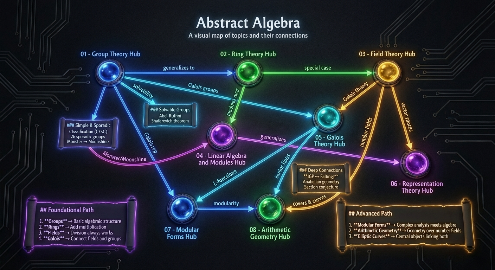

# Abstract Algebra Exercises

An Obsidian vault for studying abstract algebra, featuring exercises, concepts, and visual maps covering the major topics.



## Topics Covered

- **Group Theory** - Groups, subgroups, homomorphisms, quotient groups, Sylow theorems
- **Ring Theory** - Rings, ideals, quotient rings, PIDs, UFDs
- **Field Theory** - Field extensions, algebraic elements, splitting fields
- **Linear Algebra & Modules** - Vector spaces, linear transformations, modules over rings
- **Galois Theory** - Galois groups, fundamental theorem, solvability by radicals
- **Representation Theory** - Group representations, characters, Maschke's theorem, Lie groups, Lie algebras
- **Modular Forms** - Modular group, cusp forms, Hecke operators, L-functions, modularity theorem
- **Arithmetic Geometry** - Elliptic curves, rational points, schemes, BSD conjecture, Galois representations
- **Set Theory and Foundations** - Induction, partial orders, Zorn's lemma, cardinality and infinite sets

## Structure

```
exercise_abstract/
├── 00 - Home/           # Index, trackers, and base files
├── 01 - Group Theory/   # Concepts and exercises
├── 02 - Ring Theory/    # Concepts and exercises
├── 03 - Field Theory/   # Concepts and exercises
├── 04 - Linear Algebra and Modules/  # Concepts and exercises
├── 05 - Galois Theory/  # Concepts and exercises
├── 06 - Representation Theory/  # Concepts and exercises
├── 07 - Modular Forms/  # Concepts and exercises
├── 08 - Arithmetic Geometry/  # Concepts and exercises
├── 09 - Set Theory and Foundations/  # Concepts and exercises
├── 10 - Daily Exercise Lists/  # Configurable output folder for daily Markdown todo lists
├── Canvas/              # Visual topic maps
├── Templates/           # Exercise and concept templates
└── Attachments/         # Images and files
```

## Features

### Obsidian Bases
- **Exercise Tracker** - Track progress across all exercises
- **Concept Index** - Browse and search concepts
- **Study Progress** - Filter by difficulty and topic

### JSON Canvas
- **Abstract Algebra Overview** - High-level topic connections
- **Topic Relationships** - Detailed concept hierarchy
- **Study Roadmap** - Suggested learning path

### Templates
- **Exercise Template** - Structured format with hints and solutions
- **Concept Template** - Definitions, examples, and related concepts

## Plugins Used

- **Dataview** - Dynamic queries and progress tracking
- **Templater** - Template insertion
- **LaTeX Suite** - Math typing shortcuts
- **TikZJax** - Commutative diagrams
- **Excalidraw** - Freeform diagrams

## Getting Started

1. Open the vault in Obsidian
2. Start at `00 - Home/Index.md`
3. Follow the study roadmap or explore by topic
4. Use the Exercise Tracker to monitor progress

## Exercise Format

Each exercise includes:
- Problem statement in callout format
- Progressive hints (collapsed by default)
- Full solution (collapsed by default)
- Related concepts and notes
- YAML frontmatter for tracking (status, difficulty, topic, source)

---

## Changelog

[Full change history](CHANGELOG.md)

### 2026-10-23 (Neukirch Remaining Chapters Archive)

- Added: Archived all **212 remaining numbered exercises**, preserving one source number per note, multipart statements and printed hints, progressive hints, independent derivations or visible source corrections, precise printed/PDF locators and `not-started` status. The complete book now reconciles **293/293** source labels to **293** distinct notes (chapter totals 75, 51, 15, 51, 33, 46, 22); the previous 81 notes are preserved. Topic routing follows the principal proof toolkit (arithmetic-geometry: 39, ring-theory: 50, field-theory: 13, galois-theory: 60, linear-algebra: 33, group-theory: 14, set-theory: 1, representation-theory: 1, modular-forms: 1).
- Added: Eight required concept notes on henselian fields, higher ramification, differents, replete ideals, metrized modules, reciprocity, formal groups and Hecke characters, with dynamic exercise backlinks, existing hub entries and a prerequisite cluster in Topic Relationships. Replaced bare S4 source abbreviations in this batch's readable citations with the complete book identity; structured Exercise Manager source references retain the stable S4 ID.
- Corrected: Preserved and explicitly discussed printed source defects, missing hypotheses and normalization conflicts. Cross-review corrected an initial misreading of II.5.1: its exponential statement permits a noncanonical continuous homomorphism extension beyond the analytic convergence disc. VI.7.5 preserves the printed capital-K class-number assertion as unresolved and proves the hint's lowercase-k version; archive completeness is not a claim that this ambiguity has been solved. All other imported structural results are named at their point of use.
- Verified: Compared the complete expected source-label set against parsed note provenance: zero missing, duplicate, unexpected or unparsed entries. Checked new-note metadata, numbering, path-qualified links, MathJax delimiters, Study Progress tag discovery, concept backlinks and Canvas references. Updated independent chapter/section mapping queries and final reconciliation records, removed active-batch planning material and temporary source renders, and synchronized this latest-three README excerpt. No Git publication was performed.

### 2026-10-20 (Neukirch II.1 The p-adic Numbers Exercises)

- Archived: All six numbered exercises of Chapter II §1, printed p. 106 / PDF p. 125, as R370–R373, F128 and R374 in source order. Each note preserves the full problem, the first exercise’s printed hint, progressive collapsed hints, a complete independent solution, prerequisite links and precise S4 provenance. New learning states remain not-started.
- Proved: Eventual digit periodicity characterizes rational numbers by a bounded integer-state recurrence; the first digit detects units; a compatible root-lifting sequence constructs a square root of 2 in Z7; and the exact 5-adic expansions are for 2/3 and −2/3 (the original numerators are lost in text extraction). The abstract-automorphism proof algebraically recovers Zp, handles p=2 separately and fixes every finite truncation without assuming continuity or using a later Hensel theorem. One note retains all four digit operations, including negative borrows, division carries, nonunit denominator shifts, zero boundaries and finite-precision limits.
- Updated: Expanded the existing p-adic Numbers concept with the source’s inverse-limit construction, unit and periodicity criteria, arithmetic mechanisms and automorphism boundary; preserved its older content, metadata, partial verification status and dynamic backlinks. No new concept, folder, Base or Canvas was created. Related Lang exercises F108 and R224 remain independent source notes.
- Verified: Inspected the bounded original exercise, definition and construction pages at 200 dpi and cross-reviewed every solution. Recomputed all four root-lifting table rows and checked both signs of the 2/3 expansions modulo 5^1 through 5^20. The digit algorithms passed 20,160 finite modular equalities for p=2,3,5,7,11,13 and precision N=1–8; the worked six-digit example was independently recalculated. These finite checks supplement the all-digit proofs. Source mapping is exactly 6/6, with no missing, duplicate, unexpected or unparsed locators.
- Synchronized: Added the independent II.1 mapping query and permanent source audit, marked only that section complete, and advanced the next pointer to Chapter II §2. Chapter I remains 75/75; the complete Chapter II source total remains unknown. Checked metadata, numbering, links, Obsidian formula syntax, dynamic backlinks and the Study Progress exercise-tag filter. Preserved pre-existing dashboard/R366 changes, retained the complete changelog and synchronized README’s latest three entries. No Git commit or publication was performed.

### 2026-10-20 (Neukirch Chapter I Archive Complete — 75/75)

- Completed: Chapter I now has 75 numbered source exercises mapped one-to-one to 75 notes across all 14 sections. This batch added 44 notes (R345–R369, LA540–LA546, Gal141–Gal148, G331–G332 and F126–F127), reused I.8.2/R329, and recorded the verified zero-exercise sections I.13–I.14. All new notes remain not-started. Each numbered problem retains all its subparts, progressive hints, a complete independent solution, precise printed/PDF provenance and prerequisite links.
- Preserved and corrected visibly: I.6.2's impossible discriminant 11, I.9.2's wrong Frobenius exponent, and I.12.1's reversed parameter hint; R329's complete counterexample remains unchanged. Existing concepts now distinguish a Frobenius cycle from the entire Galois group, retain only the valid divisibility-to-cyclotomic-containment implication with a counterexample to its converse, and state residue/ramification hypotheses explicitly. Added one general Dirichlet-unit/logarithmic-lattice concept, its Hub entry and dynamic exercise backlinks; expanded only the concepts needed by this batch.
- Source audit: Checked bounded original pages at 200 dpi and independently cross-reviewed every new solution. Re-rendered the previous §1–§5 exercise pages and rechecked their 30 ordered labels. The permanent dashboard records all section totals, source anchors, the full 75-label chapter set and successful reconciliation; missing labels, duplicates, unexpected labels and unparsed source locators are all zero. The next archive pointer is Chapter II §1.
- Exact computational checks: Rechecked R329's multiplication relations, discriminant −503, all 8 quotient elements and all 64 quotient products; checked the six fundamental-unit norms; enumerated Pell-13 coefficients 1–5000 (first positive pair 649,180) and all norm-seven solutions with −10000 ≤ y ≤ 10000 (40 pairs), agreeing with the proved two-orbit classification. These bounded checks supplement the complete proofs; they are not substitutes for them.
- Final validation: Executed all 15 dashboard queries against actual note metadata: Chapter I reports 75/75, 75 files and Complete, with all 14 section results correct. Checked numbering, metadata, not-started states, topic routing, source parsing, path-qualified links, Obsidian math delimiters, dynamic backlinks and the existing Study Progress exercise-tag filter. Removed temporary source renders, retained complete changelog history and synchronized README's latest three entries. Baseline hashes preserve existing rules, daily lists, review artifacts and unrelated changes. No Git commit or publication was performed.
